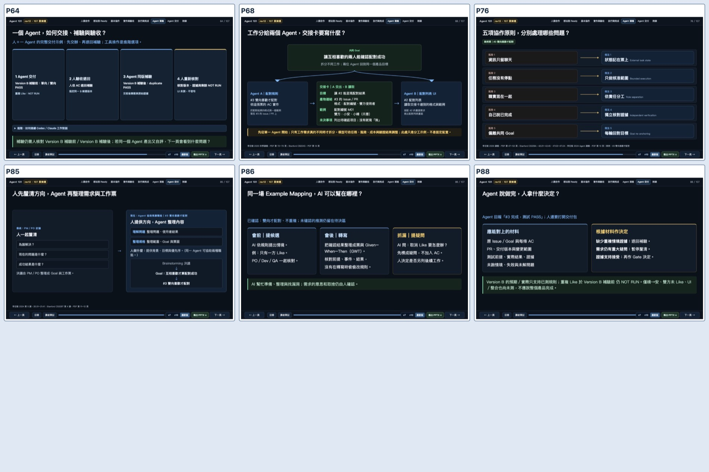
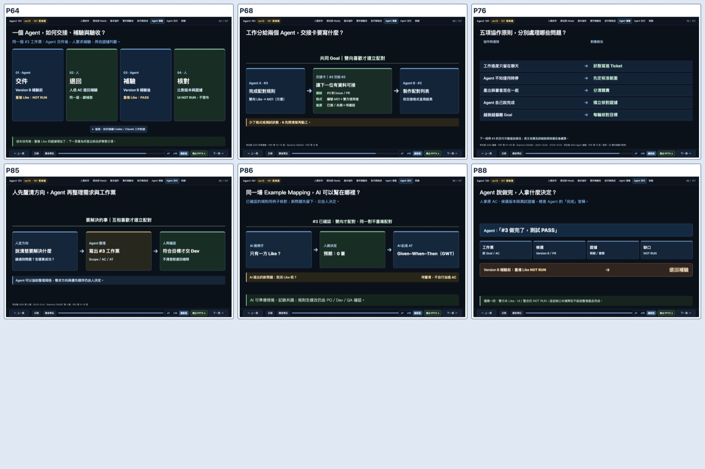
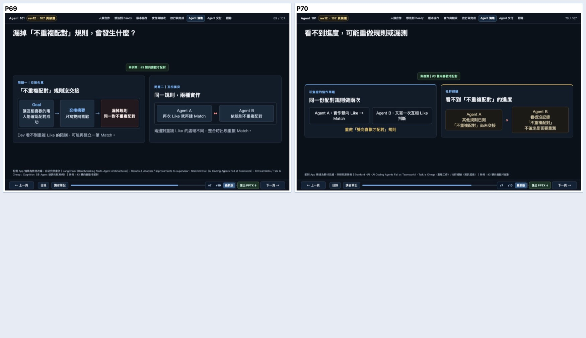
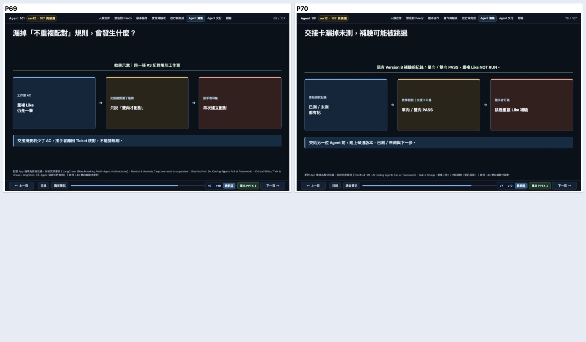

# PR #57｜全頁盤點後的八頁 G4 視覺重做（2026-10-11）

這輪先逐張查看最新 107 頁的九張縮圖總覽，挑出資訊重複、字級小或視線沒有主角的 Agent 教材頁面修正。原 rev11 的 82 頁、A01–A25 二十五頁、配對 App 和原始 A/B 測試資料都保留。

## Before／After

六張交付／驗收頁：

兩張交接風險頁：

## 全部 107 頁的最新 G4 縮圖總覽

已按實際播放順序從 P1 看到 P107。以下為最新 HTML 的九張總覽圖，便於核對章節順序與密度；縮圖只能篩選高風險頁，細字是否可讀仍須看原尺寸與實際投影。

| 頁面 | 最新總覽 | 頁面 | 最新總覽 | 頁面 | 最新總覽 |
|---|---|---|---|---|---|
| P1–12 | [檢視](full-contact-1.jpg) | P13–24 | [檢視](full-contact-2.jpg) | P25–36 | [檢視](full-contact-3.jpg) |
| P37–48 | [檢視](full-contact-4.jpg) | P49–60 | [檢視](full-contact-5.jpg) | P61–72 | [檢視](full-contact-6.jpg) |
| P73–84 | [檢視](full-contact-7.jpg) | P85–96 | [檢視](full-contact-8.jpg) | P97–107 | [檢視](full-contact-9.jpg) |

## 同頁學員可見字元變化

排除隱藏與未展開內容。字元量用於辨認重複資訊是否減少，不能單獨代表教學品質。

| 頁 | 修改前字元 | 修改後字元 | 差異 | 修改後主畫面 |
|---:|---:|---:|---:|---|
| P64 | 297 | 240 | -19.2% | Agent 交件 → 人退回 → 同版補驗 → 人核對 |
| P68 | 500 | 256 | -48.8% | 中央交接卡讓 #3 結果可交給 #2 |
| P69 | 472 | 364 | -22.9% | 交接漏掉不重複配對 AC 的單一風險 |
| P70 | 307 | 271 | -11.7% | 交接卡只寫已測 PASS，接手者可能跳過重複 Like 補驗 |
| P76 | 359 | 275 | -23.4% | 五列困難 → 具體做法 |
| P85 | 316 | 219 | -30.7% | 人定方向 → Agent 整理工作票 → 人確認 |
| P86 | 252 | 214 | -15.1% | AI 提例子 → 人確定預期 → AI 記成 AT |
| P88 | 270 | 214 | -20.7% | Agent 宣稱 PASS → 人查證據 → 未測退回 |

## 審查與研究依據

- 新增 tests/agent_projector_visual_test.py，檢查八頁教學順序、交接合約、已測／未測、人的放行權，以及圖解的實際 DOM 結構。
- 原教材、敘事、StoryBoard 與 107 頁 Chromium 回歸繼續測試；原始 B-pre／B-post fixture/hash 未改動。
- [獨立唯讀 AI 視覺審查](independent-six-slide-visual-review.md)：六張同頁 Before／After 均判定有改善，檢查範圍未發現可支持 P0／P1 的截圖缺陷。P86 的 0 筆配對、P88 的單向／雙向 PASS 範圍依 P2 建議補上。
- P69 只呈現遺漏 AC，P70 只呈現未測狀態沒交接，P71 再教 Goal 偏移，P72 對應三項工作做法。情境是教學示意，不能宣稱真實多 Agent 事故已發生。
- [P69／P70 第一次獨立審查](independent-risk-first-pass.md) 判定 P69 改善、但 P70 有 P1：真實 B-pre 證據和假設交接未分清，且同時講重做／漏測。修改 P70 標題、交接卡的「教學假設」標示和單一漏測後果；[第二次獨立審查](independent-risk-final-review.md) 根據更新後的 Before／After 截圖，沒有再發現 P0／P1。
- [Waterloo：Designing Visual Aids](https://uwaterloo.ca/centre-for-teaching-excellence/catalogs/tip-sheets/designing-visual-aids) 強調一個視覺重點、圖文對齊與留白；[Mayer／Fiorella](https://www.cambridge.org/core/books/abs/cambridge-handbook-of-multimedia-learning/principles-for-reducing-extraneous-processing-in-multimedia-learning/F29A19FCD34C542806F736E0661C05F5) 提出 Coherence、Signaling 等原則；[Mayer 等（2019）](https://onlinelibrary.wiley.com/doi/10.1002/acp.3560) 支持複雜材料的分段學習。

## 未完成範圍

本輪只重做這八頁，不能宣稱 107 頁全部已達成教學效果。其他待審候選包括 P14 的 GitHub Issue 細字、P25／P28 的表格、P29 的 WIP 範例、P90 的多欄練習和 P97 的格式比較；必須逐頁判定，不因字多就全部刪減。

真人零基礎試教、真實教室後排投影、Matching App UI／整合／部署：NOT RUN。PPTX 是網頁的靜態圖片版本，最新匯出檔需同步驗證。
